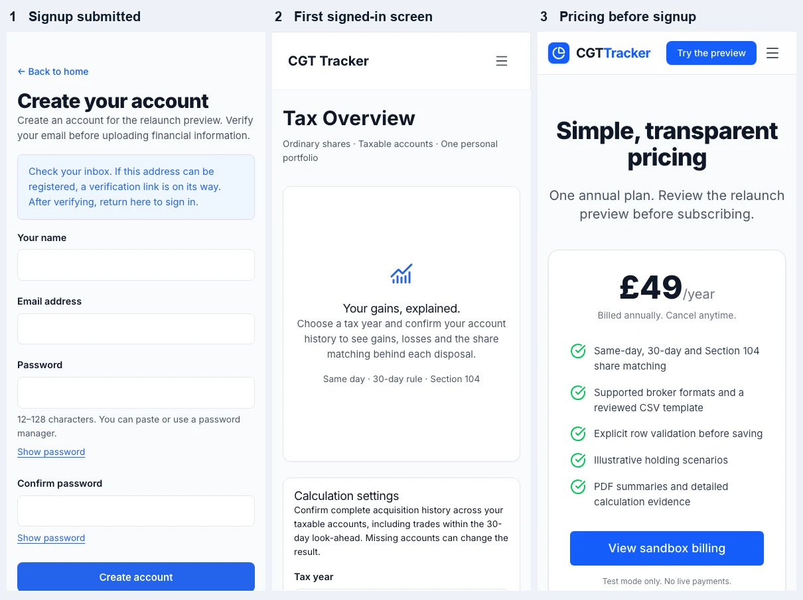

# CGT Tracker · Staging UX review and improvement plan

**18 November 2026 · Desktop and mobile · Decision before production**

Keep the original blue pie-chart identity, Inter typography, public pages and familiar workspace. The highest-return change is to connect the actions the product already supports. A first-time investor should be able to answer four questions in order. Can I use my file? Has every row been accounted for? What gain did I make? What does £49 buy me?

**Recommendation: fix the two misleading calculator states and the conflicting product promises first. Then complete one continuous journey from verified signup to a downloadable report before polishing individual pages.**

## What the journey actually felt like

| Stage | What happened on staging | Change to make |
|---|---|---|
| Decide whether to start | The homepage promises to calculate tax and illustrates exemption used and taxable gain. The real report calculates share gains and losses and omits personal allowances. The homepage FAQ and the six-broker support matrix describe different levels of readiness. On a phone the homepage is 11,098 CSS px long. | Put a truthful example disposal in the existing hero illustration. Lead with supported share gains and a traceable report. Place **Check my broker** and the free/paid boundary beside the main signup action. A visitor should be able to decide before reading the FAQ. |
| Create and verify | On mobile, signup succeeded and the owner verified the email. The success state still displays four empty fields, two password toggles and **Create account**. The success copy says to return here to sign in, although this is the registration form. The verification callback itself does provide a sign-in confirmation. | Replace the submitted form with a dedicated **Check your inbox** state. Show what happens when the link opens, a sign-in action and a resend/correct-address route. Retain the generic response for existing addresses. |
| Arrive for the first time | The verified investor landed on **Tax Overview**, with zero accounts. On mobile, the empty result card occupies about 416 px. The only main button, **Calculate gains**, starts at y=1,235 on an 844 px screen. The instruction to add accounts is plain text. Desktop also leads with calculation settings. A returning account with a published 2024–25 report was greeted by an empty result for a different selected year. | Make the overview depend on actual account state. Show **Add your first broker account**, **Upload your first file**, **Resume review**, **Calculate for [year]**, or **Open latest report**. Surface a saved year and the date of its calculation. Preserve access to every year. |
| Choose and upload | Adding a Trading 212 GIA led to Upload, where the user had to select the account they had just created. The upload form showed a source-format choice and Freetrade-specific cautions on that Trading 212 path. | Carry the new account into Upload. Name the account above the picker with a **Change** control. Start with its native export instructions, expose the reviewed template as an alternative, and ask for clarification when the file is ambiguous. Keep the ordinary-share confirmation explicit. |
| Review records | The desktop preview correctly explained two trades and one excluded interest record. Mobile reopened that same saved preview and committed both trades. **Save 2 transactions** was at y=2,155 below the still-visible upload form. The same preview also appeared as **Open preview** further down. | After file selection, move to a dedicated review step, focus its heading and collapse the original picker. Lead with the account, file, totals and unresolved count. Offer exactly one primary next action. Keep every source row, reason, and expiry visible on demand. |
| Resolve a difficult file | A live Hargreaves Lansdown row correctly blocked saving until verified details reconciled. At 390 px, one repair produced a 4,821 px page. The repair form alone took 1,577 px. Seven fields plus an attestation included AJ Bell and IBKR instructions. Keyboard submission focused the missing ISIN. An all-duplicate file also had a safe discard path. | Give each blocked row a **Resolve record** view. On desktop show source evidence beside required fields. On mobile show the row, a short reason, the fields this broker needs and **Check record**. Follow with the next unresolved row. Retain explicit human confirmation for ambiguous units, currency, fees and identifiers. |
| Calculate | The fresh account confirmed coverage, used history through 5 May 2025 and produced a 2024–25 net gain of **£5.25**. After import the page told the user to recalculate, but the main action still reviewed another file. The result did not lead to Reports. The mobile disposal table measured 881 px inside a 356 px region. | On commit offer **Calculate gains** and **Add another file**. Explain why the requested history date matters using the selected year. Keep coverage unchecked until the investor confirms it. Lead the result with year, net gain and coverage, then **View reports for 2024–25**. On mobile expose date, asset and gain together, with costs, proceeds and matching evidence in expandable detail. |
| Decide whether to pay | An unpaid customer could download CSV. Both PDF buttons looked available until clicked. On the second PDF card an entitlement message and **View subscription** appeared 418 px above the mobile viewport, with focus on the document body. The same link was visible on desktop. | Load entitlement with the cards. Use **Download CSV**, **Get summary PDF · £49/year**, or **Download summary PDF** as appropriate. If entitlement changes, announce the outcome and put recovery beside the action that triggered it. Start from a specific report and remember the year and format. |
| Checkout, cancellation and return | Desktop and mobile both opened the app-created Stripe sandbox checkout for £49/year. Stripe called the product “Annual”. Back returned to a generic unpaid billing page with no cancellation acknowledgement. A paid return combined “Test payment confirmed” with advice that returning does not confirm payment. The paid and held screens use a public header, and **Back to workspace** opens Broker accounts. | Keep Billing in the signed-in shell. Distinguish cancelled, awaiting confirmation, paid, failed, held and scheduled cancellation using reconciled status. A paid user sees **Download your [year] PDF**. A held user sees a support action and continued access to their records. Give the Stripe product and return destination recognizable CGT Tracker names. |
| Read and keep the report | The fresh account completed one £49 sandbox payment. It then had to go through Broker accounts → menu → Reports to recover its original task. Both paid PDFs opened and agreed with the free CSV and the on-screen £5.25 result. The PDFs put a UUID, ISO timestamp and engine version ahead of the gain. The evidence PDF compresses identifiers and arithmetic into prose. | Put tax year, **net gain £5.25**, covered accounts and history date at the top. Follow with an aligned disposal and matching table. Place version and trace references in a technical details section. Offer the same summary in accessible HTML for phones. Keep CSV stable for spreadsheet users. |

## Fix before inviting paying customers

| Priority | Reproducible problem | Acceptance test |
|---|---|---|
| **P0 · Old 30-day result survives an edit** | A 1 July sale and 15 July purchase showed a 14-day match. Editing the purchase to 1 September left that match visible. Submitting again changed it to 62 days and outside the window. Both sizes reproduced it. [Desktop capture](ui-review/edited-date.webp) | Editing any input immediately recalculates or removes the prior result and announces that recalculation is needed. Invalid submit identifies and focuses the first invalid field. A 390 px user sees the error where they are working. |
| **P0 · Pool total silently omits a partial purchase** | One hundred shares at £3.50 plus a second quantity of 100 with no price still displayed an unqualified pool of 100 shares costing £350. Entering £5.50 updated it to 200 shares costing £900. [Desktop capture](ui-review/partial-purchase.webp) | Distinguish an untouched blank row from a started purchase. Suppress the final result, or explicitly identify it as partial and name the excluded row. Removing a row moves focus to a sensible adjacent control. |
| **P1 · Claims outrun the service** | Besides the homepage sample and broker wording, the FAQ says raw CSVs are processed completely in memory. The import service stores the CSV in a temporary database draft, and the privacy page explains its expiry. The pricing card lists matching and validation alongside paid PDFs without identifying what is free. | A single approved support and entitlement matrix supplies home, pricing, guides, upload and reports. A visitor can correctly describe the gain calculation, free CSV, paid PDFs, eligible file and temporary preview storage before signup. Sign off actual deletion timing against the recovery policy before publishing privacy copy. |
| **P1 · Lost place across navigation and checkout** | Switching Upload → History inside the dashboard left the URL at `/dashboard`. Refresh returned to Tax Overview. Sign-in always lands there, and billing returns to accounts. | Every core destination has its own URL and selected nav item. Back, refresh, copied links, verified sign-in and Stripe return restore the intended screen and year. Validate internal return destinations. Preserve the unsaved-file warning and the server-saved preview ID. |

## Navigation and screen inventory

Retain the original URLs. Use **Overview, Broker accounts, Imports, Calculations, Reports** as the core sequence. Imports contains **Upload, Saved previews, History**. Keep scenarios under **Tools**, with **Settings & billing** and **Help** in a secondary group. Implement this first through the existing sidebar and mobile menu. On a phone, add one contextual next action in the page itself so completing a task never depends on opening the menu. On desktop keep persistent navigation, an active destination and the selected year in context.

| Screens assessed | Screen-specific decisions |
|---|---|
| Home, pricing, broker support | Preserve the public logo and original palette. Shorten the route from the hero to eligibility, price and a sample report. Link straight to the chosen broker's export instructions, supported layouts, examples and supported asset types. Explain automatic, assisted and blocked cases with examples. |
| Signup, login, verification success/failure, resend, forgot password, reset with missing token | Keep paste, password-manager support and labelled fields. Match the visible name of each password toggle to its accessible name. Offer an obvious resend path on expired links and a fresh reset link for missing tokens. Carry a safe intended destination through sign-in. |
| Dashboard overview and `/workspace` entry, Accounts | Show the next valid action for new and returning investors. Put account creation ahead of counters when empty. Separate an account's broker name, user label and taxable status. A person with two accounts at the same broker must be able to identify the right one. |
| Upload, saved/reopened preview, repair, duplicates, history and reversal | Give files a durable label wherever available. Group rows by **Needs attention / Included / Excluded / Duplicate**. Add a read-only import detail showing counts, date, source and effect on reports. Make reversal a secondary action there and retain confirmation, reason and scope. |
| Calculations, result evidence, pool snapshots, Tax-Loss Harvesting | Distinguish missing data, no disposals, incomplete coverage and an available result for a different year. Preserve transparent matching and numerical precision. In scenarios, label historical holdings and user-entered prices separately, identify the snapshot date and link empty states to a prerequisite calculation. |
| Reports, PDF summary, PDF evidence, CSV | Label year, coverage, freshness, format and access on every action. Give **Recalculate** a direct destination when reports are stale and **Resolve preview** when blocked. Name each PDF button for its document, and make a failed download retryable beside its card. |
| Billing, Stripe Checkout, Stripe portal, Settings | Keep the customer inside their workspace before and after the hosted provider. Explain the renewal date and amount, the effect of cancellation and continued access to records. Put profile, password, billing and data requests into labelled groups. Give the deletion support link a preselected request topic. |
| Public Contact and workspace Contact, privacy, service terms, 404 | Retain the user's signed-in navigation on workspace Contact and return them to their task. Support can receive a user-selected issue type and a safe reference. Keep raw broker data out of the form by default. Link 404s to a valid next destination. Ensure pricing and broker support provide a consistent path to legal and support information. |
| Guide index, Section 104, 30-day rule, rates, SA108, Trading 212, Freetrade, Hargreaves Lansdown articles | Keep readable articles and stable URLs. Show the relevant tax year and review date, link broker articles directly to that broker's import guidance, and link rule articles to the matching worked example. Give long phone articles a contents list. Review visible year labels separately from tax-content sign-off. |
| 30-day calculator, Section 104 calculator, allowance checker | Fix the stale and partial results first. The allowance checker correctly suppressed an invalid negative input in our test. Apply that clear invalid-state pattern to its neighbours. Label example-only results and link to the relevant next task with the year and broker when known. |

## Visual and accessibility direction

The original public pages have a recognizable mark and a clear blue action colour. The signed-in mobile experience loses much of that identity under a text-only header. The most consequential visual hierarchy problem is the allocation of space: the empty illustration, repeated upload form, counters and technical metadata can each outrank the decision the customer came to make.

- Use the existing pie-chart mark and compact header consistently. Give each working screen a title, current state and one prominent next action. Reuse quiet borders and cards for actual groups of information. Preserve the original promotional gradients.
- Use tabular numerals and right-aligned amounts throughout result tables and PDFs. Always pair colour with words or signs for gains, losses, blocked records and status. Keep source identifiers available for reconciliation, with human-readable labels first.
- Keep the working skip link, keyboard menus and focus return on Escape. Fix the homepage's horizontally scrolling sample table, which axe identified as unreachable by keyboard, and the signup confirmation-password toggle whose visible and accessible labels disagree. Review the small white-on-green step number and pale-blue-on-blue body text flagged for contrast. Test against the actual painted backgrounds.
- Move focus to the new step or inline error after upload, repair and payment. Restore focus after row removal and dialogs. A screen reader should announce the changed count, outcome and next action once. A mobile user should never need to scroll backwards to discover why a button failed.

## Delivery order and definition of done

| Release slice | Work and dependency | Observable completion |
|---|---|---|
| **1. Accuracy and trust** · frontend + product/content | Fix both calculator states. Reconcile homepage figures, retention wording, supported layouts and free/paid copy with the implementation. Correct the two reproducible axe findings. | Automated regressions reproduce both input-edit examples above; public claims match real report output. A keyboard user can reach and horizontally read the sample table and operate both password toggles by their visible names. |
| **2. First successful calculation** · product design + frontend | Introduce route-backed navigation and state-aware Overview. Carry account context into Upload, separate review and broker-specific repair, and connect commit → calculate → reports. Deep-link to selected year and preview without storing financial data in browser storage. | A new user can add an account, count every source row, commit once, confirm history and reach the correct year’s £5.25 result through visible next actions at both widths. Reload, Back and switching device preserve the server-saved preview. Unresolved rows cannot be committed. |
| **3. Purchase and delivery** · frontend + billing + report author | Use the routing work from slice 2 to retain report intent. Introduce entitlement-aware cards and checkout states, improve Stripe branding, then revise both PDFs and the HTML summary. Keep authorization and entitlement checks on the server. | From each locked PDF, cancel returns to the same year and document, a sandbox payment unlocks the original document, refresh never double-purchases, and a hold offers support. CSV remains available without payment. Verify totals, audit references, file names, legibility and paginated evidence. |
| **4. Supporting screens and release rehearsal** · design + content + QA | Align history, scenarios, settings, help, legal links, broker guides and free tools. Review dense working views on a real phone, including a native file picker, keyboard, zoom and downloaded PDF. | Walk the approved state matrix below with keyboard, phone and desktop. A first-time investor and a returning investor can each finish without coaching and explain coverage, gain and paid access in their own words. Carry unresolved production/legal/broker qualification items into the separate launch decision. |

**Acceptance suite.** Run a happy path and an assisted path. For all six brokers, include a recognized layout, an unknown layout, and the relevant duplicate, excluded or missing-detail cases. Then exercise an expired preview, an unsaved selection, an unverified/expired session, a failed request and retry, incomplete history, no disposals, a stale report, reversal, cancelled checkout, delayed confirmation, active subscription and billing hold. Test at 320, 390, 768 and 1440 px, at 200% zoom, and with keyboard plus VoiceOver. Test the real mobile Files picker and PDF reader. Recheck document focus, visible next actions, returning URLs and all financial outputs. These are proposed release criteria; only the cases listed in the review evidence below were observed in this pass.

**Measure success.** Baseline the current journey before changing it. Measure verified signup → first saved import → complete calculation → report viewed → checkout started → paid PDF downloaded. Track repair completion by broker and where people leave a blocked flow. For usability sessions, record whether the participant completed each task without help, how often they opened navigation to find the next step, and whether they could explain a blocked file or a £49 charge. Collect state names and counts, exclude raw CSV, amounts, email addresses, ISINs and statement references, and review collection against the privacy policy. No conversion lift or task-time estimate is claimed here.

## Review evidence and boundaries

**Journey observed.** On a newly verified staging identity we created a Trading 212 GIA, uploaded a synthetic native export on desktop, reopened its server-saved preview on mobile, committed two trades, and accounted for one excluded interest row. A 2024–25 calculation with confirmed coverage matched £10.50 of proceeds to £5.25 of cost. The CSV downloaded before subscribing. Desktop and mobile displayed the app-created Stripe sandbox checkout, and returning without paying was exercised. The same fresh account then completed one simulated £49 annual payment and downloaded the one-page summary and evidence PDFs on mobile. We opened both documents and checked the £5.25 result. An existing paid account exercised all three downloads on each device size. The fresh account retains its synthetic report and sandbox subscription for review.

**Coverage.** Browser runs covered 25 public, account and error URLs at 1440×900 and 390×844, including all seven guide articles and all three public calculators. Signed-in review covered Overview, Accounts, Upload, History, Reports, Scenarios, Settings, Contact, Billing, hosted Checkout and the Stripe customer portal. Account verification used a real inbox. The expired/invalid and successful callback presentations were also inspected directly. Password-reset screens were reviewed without changing a user's credentials. Browser checks included keyboard menu operation and focus on invalid submissions. A second pass using mobile WebKit covered Home, Signup, Overview, Upload (including selecting the fixture), Reports and Billing. Viewport emulation does not establish physical iPhone Files-picker behavior, real-device performance or screen-reader usability.

**Broker cases.** The mobile review included native Trading 212, assisted Freetrade FX, assisted Hargreaves Lansdown, Interactive Investor, the documented Interactive Brokers Flex layout and AJ Bell. An unsupported IBKR file blocked all five records. A Freetrade corporate-action fixture blocked saving even with one readable row. A valid HL correction changed one row from blocked to ready. Test previews used for these probes were discarded. These observations establish interface behavior with the specified fixtures. Compatibility with real-world historical exports remains a separate qualification.

**Impeccable assessment.** Independent design and technical reviews were combined with direct browser evidence. The original mark, gradients and card language are intentional design choices. The source detector returned 33 flags, mostly colour, radius and guide-callout treatments. Representative rendered scans returned 66 desktop and eight mobile flags across differently sampled screens. These counts include repeated heuristics and do not count customer-facing defects. We retained the corroborated contrast, semantics, hierarchy and task-flow findings. The two serious axe findings in the sampled mobile audit were the public example table and the confirmation-password toggle. No detector rule was suppressed.

| Usability heuristic | Score / 4 | Reason |
|---|---:|---|
| Visibility of status | 2 | Row counts and save outcomes are clear; checkout and edited calculator values can communicate the wrong state. |
| Match with the user's world | 2 | Pounds, broker names and actual match evidence help; the tax promise and gain output differ. |
| User control and freedom | 2 | Draft discard, reversal confirmation and a reachable Stripe portal work; return paths lose context. |
| Consistency and standards | 2 | Public branding is consistent; workspace routing, billing navigation and action labels diverge. |
| Error prevention | 2 | Broker validation prevents partial saves; the public calculators permit misleading partial or stale results. |
| Recognition over recall | 1 | Users must remember account, year, format and next destination across steps. |
| Flexibility and efficiency | 2 | Cross-device drafts and free CSV work; repeat account selection and long repairs cost time. |
| Visual hierarchy | 2 | Primary buttons are recognizable; the mobile empty state and metadata outrank useful actions. |
| Error recovery | 2 | Specific repair reasons and keyboard focus help; offscreen paywalls and generic support routes interrupt recovery. |
| Help and documentation | 3 | Detailed guides and broker notes exist; contextual routing and broker-specific help need work. |
| **Total** | **20/40** | **Acceptable with significant work needed.** An expert assessment of the observed journeys, not a customer satisfaction measurement. |

The first implementation milestone is complete when someone can start with a supported file and reach a trustworthy result without guessing which page comes next. The commercial milestone is complete when someone can make an informed purchase and receive the exact report they selected.
